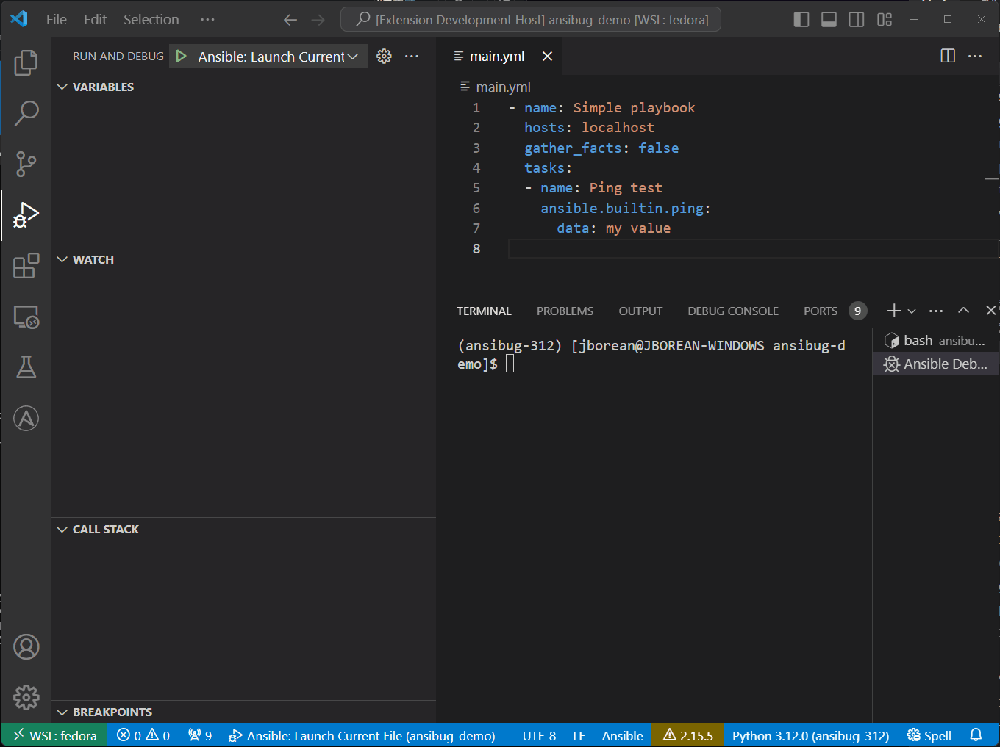

# VSCode Extension for Debugging Ansible Playbooks
This extension add debugging support for Ansible playbooks to Visual Studio Code.
This extension has no official affiliation or endorsement with Ansible and Red Hat and is a community project.

## Features
Debugging support comes from the [ansibug](https://pypi.org/project/ansibug/) Python module.
It can set breakpoints through Ansible playbook and task files and step through the tasks inside that file like a normal debugger.

A playbook can be debugged without a launch configuration through the `Debug` and `Debug with Args...` actions shown above the playbook and in the editor title run menu.
`Debug with Args...` prompts for the `ansible-playbook` arguments, like `-i inventory.ini -e key=value`, and remembers them for that playbook.
Use `Ansibug: Save Ansible Playbook Arguments as Launch Configuration` to add them to `launch.json`, or `Ansibug: Clear Saved Ansible Playbook Arguments` to forget them.

See the [ansibug documentation](https://jborean93.github.io/ansibug/) for more information on how this works with Ansible.

## Requirements
The following Python requirements must be met before using this extension:

+ [ansibug](https://github.com/jborean93/ansibug)
+ `Ansible` must also be installed for `ansibug` to interact with

For Windows users, this extension can be used with remote extensions like `Remote -WSL`, `Remote - SSH`, and `Remove - Containers`.
This extension can run alongside the official [vscode-ansible](https://github.com/ansible/vscode-ansible) extension.

## Extension Settings
This extension contributes the following settings:

+ `ansibug.interpreterPath`: Path to the `python`/`python3` executable where Ansible and `ansibug` is installed
+ `ansibug.logFile`: Path to a log file to store any logging information during a run
+ `ansibug.logLevel`: The logging level to configure for the debug server
+ `ansibug.showCodeLens`: Show the `Debug` and `Debug with Args...` actions at the top of playbooks, defaults to `true`

This extension will also use the setting `ansible.python.interpreterPath` set by the official `vscode-ansible` extension as a fallback value for `ansibug.interpreterPath`.
Both settings support `${workspaceFolder}`, and a relative path is resolved from the workspace folder.

If neither setting is set, the first of these interpreters that can run `ansibug` is used:

+ The interpreter selected in the [Python Environments](https://marketplace.visualstudio.com/items?itemName=ms-python.vscode-python-envs) extension, if installed
+ The interpreter selected in the [Python](https://marketplace.visualstudio.com/items?itemName=ms-python.python) extension, if installed
+ A `.venv` or `venv` virtual environment in the workspace folder
+ `python3` or `python` from `PATH`
